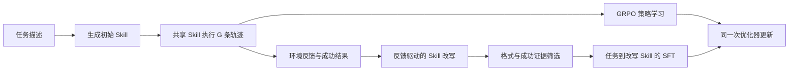

# ReSkill-GRPO

**通过执行反馈改写程序性 Skill，并与 GRPO 联合训练的智能体学习方法。**

ReSkill-GRPO 在执行任务之前生成一个任务相关的 Skill，让同一组轨迹共享该 Skill；执行结束后，模型根据轨迹与环境反馈改写 Skill，再把通过筛选的改写结果用于辅助 SFT。生成、执行和改写使用同一个策略模型，不需要预先准备静态 Skill 库或额外的改写教师模型。

## 方法流程



1. **生成 Skill**：仅根据任务描述，生成 `<skill>...</skill>` 包裹的执行前程序。
2. **执行与反馈**：同一任务组的 `G` 条轨迹共享初始 Skill；每轮动作仍根据当前环境观察决定。保存动作、奖励、有效性和下一观察。
3. **改写 Skill**：策略模型读取原 Skill 及轨迹反馈，贪心生成一次改写；长轨迹按预算摘录并保留各条轨迹的结果。
4. **筛选监督样本**：检查格式和上下文预算，默认还要求原轨迹组至少有一次成功。
5. **联合更新**：GRPO 优化执行行为，Skill SFT 学习改写后的程序；二者在同一次梯度裁剪和优化器更新中完成。

常规 Skill SFT 的条件是**任务及最初的 Skill 生成提示词**，标签是改写后的 Skill。执行反馈只用于构造改写目标，不直接作为这项 SFT 的输入。

## 训练目标

$$
\mathcal L = \mathcal L_{\mathrm{GRPO}}
+ \lambda_{\mathrm{skill}}\mathcal L_{\mathrm{skill}}
+ \beta_{\mathrm{KL}}\mathcal L_{\mathrm{KL}}
- \alpha\mathcal H.
$$

其中，`L_skill` 对每个 Skill 的生成 token 计算平均 NLL，再按样本平均。标签包含 Skill 标记和 EOS；提示词不参与这项监督。默认 `λ_skill=0.1`、`β_KL=0.01`，KL 参考模型保持冻结。

**筛选通过不等于质量提升。** 原 Skill 的成功轨迹不能证明改写后的 Skill 更好；语义错误、遗漏必要步骤和虚构位置仍需通过轨迹审查及独立验证检查。

可选的 [Rewrite Quality Loss](docs/method.md#可选重写质量监督) 实现保留在仓库中，当前 4B 实验默认关闭。

## 文件结构

```text
reskill-grpo/
├── README.md                 # 方法介绍和实验入口
├── method/                   # 核心实现的快捷入口；相对链接，不重复拷贝代码
├── experiments/
│   └── launchers/            # 原实验启动与监督脚本的快捷入口
├── configs/
│   ├── current_4b.json       # 当前实验参数索引，仅用于阅读核对
│   └── ppo_trainer.yaml      # 原 Hydra 配置的快捷入口
├── tests/                    # 原测试目录的快捷入口
├── docs/
│   ├── method.md             # 实现细节、提示词和验证边界
│   ├── structure.md          # 路径对应和代码来源
│   └── reference/            # 整理前文档与源码快照记录
└── framework/                # 保留原内部布局的训练基础设施及适配代码
    ├── verl/
    ├── agent_system/
    ├── gigpo/
    ├── launchers/
    └── tests/
```

本次整理只移动文件、增加入口链接和更新说明；**不改训练代码、导入方式或实验算法**。核心实现仍在 `framework/` 的原内部路径，`method/` 指向这些文件，避免维护两份代码。完整对应关系见 [目录说明](docs/structure.md)。

## 核心代码

| 内容 | 实现 |
|---|---|
| Skill 生成、条件注入、改写、筛选与 SFT | [reskill_grpo.py](framework/verl/trainer/ppo/reskill_grpo.py) |
| 可选重写质量监督 | [rewrite_quality.py](framework/verl/trainer/ppo/rewrite_quality.py) |
| 跨 rank 非有限数值检查 | [numerics.py](framework/verl/utils/numerics.py) |
| 分阶段 GPU 资源记录 | [gpu_resource_trace.py](framework/verl/utils/gpu_resource_trace.py) |
| Qwen3.5 打包序列边界处理 | [packed_hybrid.py](framework/verl/models/transformers/packed_hybrid.py) |
| GRPO、KL 与联合优化接入 | [Actor](framework/verl/workers/actor/dp_actor.py) · [核心损失](framework/verl/trainer/ppo/core_algos.py) |

## 当前 4B 实验配置

| 配置 | 值 |
|---|---|
| 模型 / 环境 | Qwen3.5-4B / ALFWorld 文本环境 |
| GPU | 4 张，FSDP + 同步 vLLM |
| 每步任务组 / group size | 16 / 8 |
| 学习率 / gamma | `1e-6` / `0.95` |
| PPO mini-batch | 256 |
| Skill SFT 系数 | 0.1 |
| KL 类型 / 系数 | `low_var_kl` / 0.01 |
| 重写质量监督 | 关闭 |
| 训练步数 / checkpoint 间隔 | 180 / 50 |
| 验证间隔 / 执行数量 | 5 / 128 |
| 初始 Skill / 改写生成预算 | 256 / 384 token |
| 每条环境轨迹上限 | 30 步 |

参数汇总见 [current_4b.json](configs/current_4b.json)；实际启动配置仍由原脚本和 Hydra 覆盖项组成。本仓库不包含模型权重、数据集、日志、checkpoint 或账号凭据。

现有实验入口为 [4B 启动脚本](framework/launchers/local_train/run_qwen35_4b_fresh_kl_eos_fixed.sh)。历史本机脚本的路径设置原样保留；本次没有把它们重写为跨机器安装器。使用原环境运行测试时，进入保留了原内部布局的目录：

```bash
cd framework
python -m unittest discover -s tests -p 'test_*.py' -v
```

## 稳定性与验证

- 训练掩码使用实际生成长度，排除补齐 token；结束符元数据与 tokenizer 一致。
- PPO 比率和已裁剪 KL 的指数计算包含防溢出处理。
- 非有限 loss / 梯度会拦截异常更新，并保存诊断；连续异常保留保护停机。
- 每隔 5 步保存验证时实际生成的 Skill；验证阶段不根据执行结果改写或训练。

当前训练使用 `train` 实例池；周期性验证使用 `valid_seen`。128 次验证允许重复抽取，并非固定覆盖所有 140 个不同实例。单次高分不能直接视为完整验证集或 `valid_unseen` 上的稳定成绩。

## 代码来源

训练基础设施基于 [Self-Distillation-AgentRL](https://github.com/aim-uofa/Self-Distillation-AgentRL)，并沿用 veRL、verl-agent / GiGPO 等组件。`framework/` 保留必要的基础设施、内部路径和版权声明；仓库首页聚焦 ReSkill-GRPO 方法，不沿用上游论文的研究结论或官方项目身份。

源码使用 [Apache-2.0](LICENSE)，第三方声明见 [Notice.txt](Notice.txt) 和 [来源说明](docs/structure.md#来源与保留范围)。
